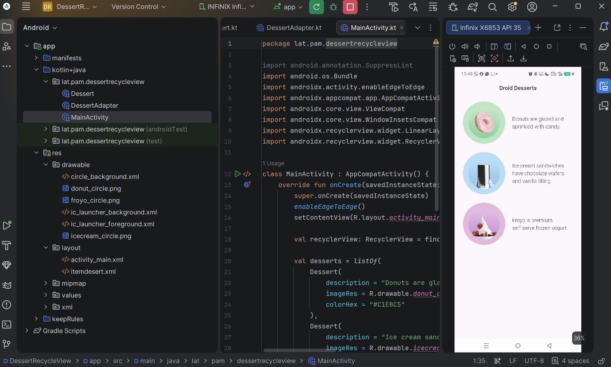
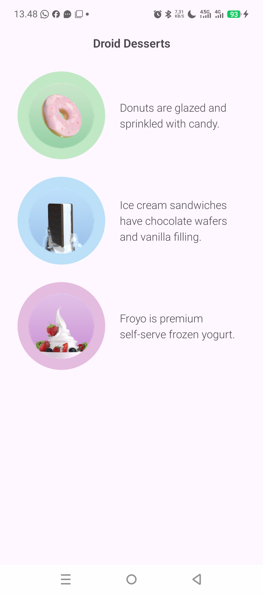

# Dessert RecyclerView

Modifikasi tampilan halaman Desert menjadi **RecyclerView** pada aplikasi Android. Aplikasi menampilkan daftar dessert lengkap dengan gambar dalam lingkaran berwarna dan deskripsinya. Project ini dibuat untuk praktikum Pengembangan Aplikasi Mobile, Materi 6: RecyclerView (Modul 2).

## Informasi Project

| Keterangan | Isi |
|---|---|
| Nama Project | DessertRecycleView |
| Package | `lat.pam.dessertrecycleview` |
| Bahasa | Kotlin |
| Minimum SDK | API 27 ("Oreo"; Android 8.1) |
| Template | Empty Views Activity |

## Daftar Dessert

| Dessert | Deskripsi | Warna Lingkaran |
|---|---|---|
| Donut | Donuts are glazed and sprinkled with candy. | `#C1E8C5` |
| Ice Cream Sandwich | Ice cream sandwiches have chocolate wafers and vanilla filling. | `#BBE0F8` |
| Froyo | Froyo is premium self-serve frozen yogurt. | `#E4BCDF` |

## Struktur File

| File | Fungsi |
|---|---|
| `circle_background.xml` | Drawable berbentuk lingkaran (oval) sebagai latar gambar |
| `activity_main.xml` | Layout utama berisi judul "Droid Desserts" dan RecyclerView |
| `itemdesert.xml` | Layout untuk satu item (gambar dalam lingkaran dan deskripsi) |
| `Dessert.kt` | Data class berisi `description`, `imageRes`, dan `colorHex` |
| `DessertAdapter.kt` | Adapter yang menampilkan data dessert ke RecyclerView |
| `MainActivity.kt` | Membuat daftar dessert, lalu memasang adapter dan layout manager |
| `drawable/*.png` | Gambar dessert: `donut_circle`, `icecream_circle`, `froyo_circle` |

## Cara Kerja

1. `MainActivity` mengambil RecyclerView berdasarkan id `recyclerView`.
2. Dibuat daftar `Dessert` berisi 3 data (deskripsi, gambar, dan warna).
3. RecyclerView diberi `LinearLayoutManager` agar tampil vertikal.
4. List dikirim ke `DessertAdapter`, lalu adapter dipasang ke RecyclerView.
5. Pada `onBindViewHolder`, adapter mengisi deskripsi dan gambar, lalu mengubah warna lingkaran secara dinamis memakai `GradientDrawable`.

## Hasil

### Kode dan Tampilan Aplikasi

### Tampilan Aplikasi

## Cara Menjalankan

1. Clone atau download repository ini.
2. Buka project di Android Studio.
3. Tunggu proses sinkronisasi selesai.
4. Jalankan aplikasi dengan tombol **Run ▶** pada emulator atau perangkat Android.